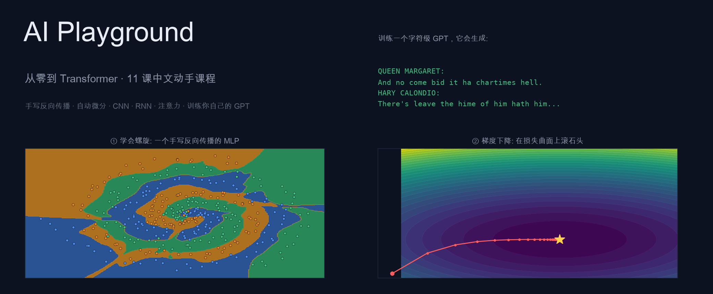

# AI Playground — 从零到 Transformer 的动手学习之路



> 为有 **物理 + 传统 CS 背景** 的学习者定制的深度学习入门课程。
> 每一课都可以运行、修改、玩坏、修好。终点：**亲手写一个字符级 GPT，在你的 Mac 上训练并让它写莎士比亚**。
>
> 🌐 **[课程网站首页](index.html)**（路线图 + 进度打卡）· 每课配有 [互动网页版](pages/01_numpy.html)（讲解精华 + 可玩 demo）

## 设计哲学

1. **先造轮子，再用轮子**。前 5 课用纯 NumPy 从线性回归一路写到自动微分引擎，第 6 课才切换 PyTorch。
   学完之后，`loss.backward()` 对你永远不再是黑盒。
2. **每个概念都能跑**。每课代码直接运行、自动出图。改一个参数，重跑，看图变化——直觉就是这么长出来的。
3. **物理类比贯穿始终**。你是物理出身，这是你的超能力：
   - softmax ≈ **玻尔兹曼分布**（logit 是能量，temperature 就是温度）
   - sigmoid ≈ **费米–狄拉克分布**
   - 反向传播 ≈ **伴随方法**（adjoint method，PDE 优化里天天用）
   - 卷积 ≈ **Green 函数 / 线性系统响应**
   - 梯度下降 ≈ **过阻尼动力学**：能量面（loss landscape）上滚石头
4. **只造必要的轮子**。反传引擎手写一遍就够，CNN/RNN/GPT 用 PyTorch 写——那是工业界的通用语言。
5. **讲优势必配反面教材**。课程里每个"这样设计好"都有能跑的对照组：学习率拉大会发散、
   全零初始化学不动、忘记 `zero_grad()` 会爆炸、摊平 MLP 打不过卷积、
   拆掉残差/位置编码的 GPT 立刻变差……物理学的老规矩：没有对照的结论不算结论。

## 学习路线图（共 11 课，约 40~60 小时）

按顺序学习。每课先读 `README.md`（推导 + 图解），再运行/修改代码，最后做练习。

- [ ] **[00_setup](00_setup/)** — 环境搭建与自检（~30 min）
- [ ] **[01_numpy](01_numpy/)** — NumPy 速成：向量化思维、广播、einsum（~2 h）· 🌐 [互动页](pages/01_numpy.html)
- [ ] **[02_gradient_descent](02_gradient_descent/)** — 线性回归与梯度下降：损失曲面、学习率（~2 h）· 🌐 [互动页](pages/02_gd.html)
- [ ] **[03_logistic_regression](03_logistic_regression/)** — 逻辑回归：sigmoid、交叉熵、softmax（~2 h）· 🌐 [互动页](pages/03_sigmoid.html)
- [ ] **[04_neural_network](04_neural_network/)** — 纯 NumPy 神经网络 + 反向传播完整推导（~5 h，全程最重要的一课）· 🌐 [互动页](pages/04_mlp.html)
- [ ] **[05_autograd](05_autograd/)** — 手写 micrograd：标量级自动微分引擎（~4 h）· 🌐 [互动页](pages/05_autograd.html)
- [ ] **[06_pytorch](06_pytorch/)** — PyTorch 入门：用 30 行重写第 4 课的 150 行（~3 h）· 🌐 [互动页](pages/06_pytorch.html)
- [ ] **[07_cnn](07_cnn/)** — 卷积神经网络：MNIST 99%（~4 h）· 🌐 [互动页](pages/07_cnn.html)
- [ ] **[08_sequence_models](08_sequence_models/)** — 语言建模：bigram → MLP → RNN，梯度消失（~4 h）· 🌐 [互动页](pages/08_lm.html)
- [ ] **[09_attention](09_attention/)** — 注意力：QKV、scaled dot-product、因果掩码（~4 h）· 🌐 [互动页](pages/09_attention.html)
- [ ] **[10_transformer](10_transformer/)** — 组装 GPT（nanoGPT 风格）并训练（~6 h）· 🌐 [互动页](pages/10_transformer.html)
- [ ] **[playground](playground/)** — 随时打开的网页版神经网络游乐场（配合 02~04 课）；
      双击 **`启动Playground.command`** 一键启动+开浏览器，或直接双击 `playground/index.html`（无需服务器）。
      想懂它的原理/数学/每行代码 → [playground/README.md](playground/README.md)

## 快速开始

```bash
conda activate aiplay          # 已为你建好的环境 (python 3.12, base 环境未动)
python 00_setup/check_env.py   # 自检：numpy / matplotlib / torch / MPS 加速

# 然后逐课学习，例如第 2 课：
cd 02_gradient_descent
open README.md                 # 先读推导
python linear_regression.py    # 运行代码，图表自动存入 figures/
```

> ✅ **全部代码已在你这台机器上跑通验证**（含每课演示脚本与练习参考答案），
> 一键复验：`bash _run_all_tests.sh`（约 15 分钟）。几个标志性结果：
> 手写反向传播通过数值梯度检查（误差 7×10⁻¹⁰）· CNN 在 MNIST 上 **98.87%** ·
> 字符级 GPT 训练到困惑度 **6.0** 并生成"伪莎士比亚"（见 [10_transformer/README.md](10_transformer/README.md)）。

每课目录结构统一：

```
02_gradient_descent/
├── README.md      ← 先读这个：核心思想、数学推导、物理类比
├── *.py           ← 再跑这个：可直接运行，自动生成 figures/ 下的图
├── exercises.py   ← 然后做练习：把 NotImplementedError 补全
├── solutions.py   ← 卡住了再看参考答案
└── figures/       ← 运行脚本后自动生成的图
```

## 学习建议

- **动手 > 阅读**：代码里所有标了 `# 实验` 的地方，改改参数再跑一遍。训练崩溃了？好事，那是直觉在增长。
- **练习先自己写**：`exercises.py` 里的每个函数都有测试（`python exercises.py` 会告诉你过没过），写不出来再看 `solutions.py`。
- **卡住就问我**：在这个会话里继续问，我可以逐行讲解、画图解释、或者陪你 debug。
- ** Playground 放在手边**：浏览器打开 `playground/index.html`，学第 2~4 课时边玩边对照。

## 记号约定（全课程统一）

| 记号 | 含义 |
|---|---|
| $x, y$ | 输入、标签（监督学习）或目标 token（语言模型） |
| $\hat{y}$ | 模型预测 |
| $W, b$ | 权重矩阵、偏置 |
| $z = Wx+b$ | 预激活（pre-activation） |
| $a = \phi(z)$ | 激活值（activation），$\phi$ 为激活函数 |
| $L(\theta)$ | 损失函数，$\theta$ 表示所有可学习参数 |
| $\eta$ 或 `lr` | 学习率 |
| $\partial L/\partial W$ | 损失对权重的梯度（反传时逐层算出） |

## 致谢与参考

本课程的路线致敬 Karpathy 的 **micrograd → nanoGPT** 教学传统，完整资源清单见
[references.md](references.md)（视频、教材、论文、代码，含中文资源）。
